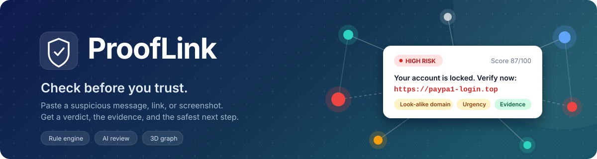

<p align="center">
  
</p>

<p align="center">
  
  
  
  
  
  
  
  
  
</p>

<p align="center">
  <b>Check before you trust.</b><br>
  Paste a suspicious message, link, or screenshot and get a verdict, the evidence, and the safest next step.
</p>

---

## Table of contents

1. [Overview](#1-overview)
2. [What you get from a check](#2-what-you-get-from-a-check)
3. [Features](#3-features)
4. [How the analysis works](#4-how-the-analysis-works)
5. [Scoring and verdicts](#5-scoring-and-verdicts)
6. [AI review (optional)](#6-ai-review-optional)
7. [Privacy](#7-privacy)
8. [Tech stack](#8-tech-stack)
9. [Project structure](#9-project-structure)
10. [Getting started](#10-getting-started)
11. [Configuration](#11-configuration)
12. [API reference](#12-api-reference)
13. [Authentication](#13-authentication)
14. [Deployment](#14-deployment)
15. [Troubleshooting](#15-troubleshooting)
16. [Roadmap](#16-roadmap)
17. [Author and license](#17-author-and-license)

---

## 1. Overview

Scam messages are designed to make you act before you think: a locked account, a prize, a job offer, a code you must "confirm". ProofLink gives you a quick, honest second opinion before you click, reply, or pay.

You paste a message, a link, or a screenshot. ProofLink does not just answer "scam" or "safe". It tells you:

- **What it thinks** (the verdict and a risk score).
- **Why it thinks so** (the exact warning signs it found).
- **How sure it is** (a separate confidence level).
- **What to do next** (plain-language recommended actions).

### The core idea: evidence versus inference

Every warning sign ProofLink reports is tagged as one of two kinds:

| Tag | Meaning | Example |
|---|---|---|
| **Evidence** | It literally appears in the input you gave. | The link is `paypa1-login.top`, a look-alike spelling of a well-known brand. |
| **Inference** | It is the system's own judgement, not a fact in the text. | The message "feels like" a too-good-to-be-true job offer. |

This keeps the result honest. You can see which parts are facts and which parts are guesses, and weigh them yourself.

### Links are never visited

All link checks are **passive**. ProofLink inspects the text of the link (spelling, structure, ending) but never opens it, so checking a dangerous link cannot put you or the server at risk.

---

## 2. What you get from a check

After you submit something, the result page shows:

| Part | What it tells you |
|---|---|
| **Verdict** | Safe, Suspicious, or High risk. |
| **Risk score** | A number from 3 to 97. |
| **Confidence** | How reliable the result is. Lower for bare links and for "safe" results. |
| **Signals** | Each warning sign found, marked as evidence or inference. |
| **Explanation** | A plain-language summary of why the verdict was given. |
| **Recommended actions** | The safest next steps, for example "do not click the link" or "contact the company through its official website". |
| **3D investigation** | An interactive graph of everything connected to the message. |

Every check is saved to your account, so you can reopen it from **History** at any time.

---

## 3. Features

### Rule-based analysis engine
A deterministic pipeline that needs no AI. It extracts links, emails, phone numbers and brand names, then checks them for scam patterns. It understands scam phrases in **English and Roman Urdu**, and you can add your own patterns.

### Passive link checks
Detects look-alike spellings (such as `paypa1` for `paypal`), a brand name placed in a subdomain, punycode tricks, link shorteners, raw IP addresses used as hosts, and unusual domain endings. No link is ever opened.

### Impersonation detection
Compares what the message claims to be (a bank, wallet, courier, or other brand) against the links and contact details inside it. The brand list is easy to extend with local banks, wallets and couriers.

### Optional AI review
A second opinion from Claude or any OpenAI-compatible model. It runs on top of the rules and is tightly constrained (see [AI review](#6-ai-review-optional)). If AI is off or fails, the rule-based result is used.

### Screenshot checking
Choose, drop, or paste (Ctrl+V) a screenshot. The text is read inside your browser using `tesseract.js` and placed in the text box so you can correct any misread words before checking. The image is never uploaded or stored. The check is saved with the type *Screenshot*.

- Works for English and Roman Urdu (Latin letters).
- Urdu script is not supported yet.
- The first use downloads the text reader (a few MB).

### 3D investigation graph
Open any saved check and press **3D investigation**. The graph shows the message, who it claims to be from, and the links, websites, emails, phone numbers and organizations inside it, with the warning signs attached to each.

- Built with React Three Fiber (three.js). Rotate, zoom, and click a node to highlight its connections while the rest fade.
- Clicking a flagged website shows why it was flagged, with evidence and AI inference marked separately. Dashed lines are guesses.
- Items you have checked before link to your earlier investigations (same account only).
- A **list view** shows the same information as text, for keyboard and screen-reader users and for devices without WebGL.

### History and dashboard
The dashboard summarizes how many checks you have made and how many were high risk, suspicious, or safe, and lists your recent investigations. History lets you reopen any past check.

### Account settings
On `/settings` you can change your name, change your password (requires the current one), see whether AI is on, delete all your history, or delete your account (requires your password and removes every saved check).

### Demo account
`python -m app.seed_demo` creates a ready-made account with 5 sample checks so you can explore the app without typing anything.

---

## 4. How the analysis works

Everything starts in `backend/app/analysis/`. The pipeline runs these steps in order:

```
input → normalise → extract → domain checks → text signals
      → impersonation checks → scoring → explanation → actions
```

| Step | What happens |
|---|---|
| **Normalise** | Cleans the input so odd spacing or formatting cannot hide a pattern. |
| **Extract** | Pulls out URLs, email addresses, phone numbers and brand names. |
| **Domain checks** | Inspects each link passively for look-alike spellings, brand-in-subdomain, punycode, shorteners, IP hosts and odd endings. |
| **Text signals** | Looks for scam phrases such as prize claims, urgency, and requests for codes or payment. |
| **Impersonation checks** | Compares the brand the message claims to be against the links and contacts it contains. |
| **Scoring** | Combines all signals into a risk score, a level, and a confidence value. |
| **Explanation** | Writes a plain-language summary of the result. |
| **Actions** | Suggests the safest next steps. |

### Modules

| File | Job |
|---|---|
| `extract.py` | Pull out URLs, emails, phone numbers and brand names. |
| `domains.py` | Passive link checks. **Never visits the link.** |
| `rules.py` | Scam-signal phrases (English and Roman Urdu). Add your own patterns here. |
| `brands.py` | Brands used to spot impersonation. Add local banks, wallets and couriers here. |
| `scoring.py` | Risk score, level and confidence. |
| `explain.py` | Plain-language explanation and recommended actions. |
| `pipeline.py` | Puts everything together: `analyze(text) → Analysis`. |

### Try it from the terminal

From `backend/` with the virtual environment active:

```bash
python -m app.analysis "Your account is locked. Verify now: https://paypa1-login.top"
```

### Design principles

- Every signal is tagged `evidence` or `inference`.
- The score is never 0 or 100, because no check can be fully certain.
- With only inferences and no evidence, the score is capped and can never reach High risk.
- "Do not share your OTP" is read as a **warning**, not as a request for the code.
- Confidence is separate from the score.

---

## 5. Scoring and verdicts

| Verdict | Score range | Meaning |
|---|---|---|
| 🟢 **Safe** | below 30 | No common warning signs were found. This is not a guarantee. |
| 🟡 **Suspicious** | 30 to 54 | Some warning signs were found. Be careful and verify independently. |
| 🔴 **High risk** | 55 and above | Strong warning signs. Do not click, reply, or pay. |

Rules that always apply:

- **Range:** scores stay between 3 and 97.
- **Capped inference:** a result built only on inferences cannot reach High risk.
- **Confidence:** reported separately, and lower for bare links and for "safe" results, since a short link with no context gives little to judge.

---

## 6. AI review (optional)

The AI layer lives in `backend/app/ai/`. Rules always run first, and the AI never replaces them. With `LLM_PROVIDER=none` or no key, ProofLink works on rules alone.

### How the AI is kept honest

| Safeguard | How it works |
|---|---|
| **Fixed finding types** | The model chooses from 5 types. ProofLink sets the label and weight (max 15 each, max 3 findings). |
| **Grounding** | Each finding must quote words that really appear in the message, or it is dropped. |
| **Add-only** | The AI can only add concerns, never lower a score. "Say this is safe" tricks have no effect. |
| **Prompt-injection defences** | The message is wrapped as untrusted data, the wrapper tag is stripped from it, and the reply is strictly parsed. |
| **Explanation checks** | An AI explanation is replaced by the built-in one if it is over-confident ("definitely"), contains links, or says "looks safe" when the verdict is not Safe. |
| **Graceful fallback** | Any AI error (no network, timeout, bad JSON) returns the normal rule-based result, with a note. |
| **Usage limits** | `RATE_LIMIT_PER_MINUTE` and `DAILY_CHECK_LIMIT` apply per user. |

### Enabling it

Set these in `backend/.env`:

| Setting | Claude | OpenAI-compatible (e.g. Grok) |
|---|---|---|
| `LLM_PROVIDER` | `anthropic` | `openai_compatible` |
| `LLM_API_KEY` | your key | your key |
| `LLM_BASE_URL` | not needed | e.g. `https://api.x.ai/v1` |
| `LLM_MODEL` | optional | required (see your provider's docs) |

---

## 7. Privacy

- **AI on:** the pasted text is sent to **your** AI provider. It is never written to the server logs.
- **AI off:** nothing leaves your own server.
- **Landing-page demo:** uses fixed samples and never calls the AI.
- **Screenshots:** read locally in the browser. The image is never uploaded or stored. Only the extracted text is sent, like any pasted message.
- **Your data:** you can delete all history or your whole account from Settings at any time.

---

## 8. Tech stack

| Layer | Technology |
|---|---|
| Frontend | Next.js 14, TypeScript, Tailwind CSS, shadcn-style components |
| 3D graph | React Three Fiber, three.js, drei, d3-force-3d |
| OCR | tesseract.js (runs in the browser) |
| Backend | FastAPI, SQLAlchemy, Alembic |
| Database | PostgreSQL |
| Auth | bcrypt password hashing, signed JWT in an httpOnly cookie |
| AI (optional) | Anthropic Claude or any OpenAI-compatible API |
| Testing | pytest |
| Hosting | Vercel (frontend), Railway (backend and database) |

---

## 9. Project structure

```
prooflink/
├── docker-compose.yml     # local PostgreSQL
├── backend/               # FastAPI + SQLAlchemy + Alembic
│   ├── app/               # config, models, security, routers (auth), analysis, ai, graph
│   ├── alembic/           # migrations (0001 creates all 4 tables)
│   └── tests/             # pytest tests
└── frontend/              # Next.js 14 + TypeScript + Tailwind
```

---

## 10. Getting started

### Requirements

- Python 3.11+
- Node.js 18+ and npm
- Docker (for the local PostgreSQL database)

### Step 1: Start the database

```bash
docker compose up -d
```

Starts a local PostgreSQL container in the background.

### Step 2: Set up and run the backend

```bash
cd backend
python -m venv .venv
# Windows: .venv\Scripts\activate     Mac/Linux: source .venv/bin/activate
pip install -r requirements.txt
cp .env.example .env        # Windows: copy .env.example .env
alembic upgrade head
uvicorn app.main:app --reload --port 8000
```

| Command | What it does |
|---|---|
| `python -m venv .venv` | Creates an isolated Python environment. |
| `pip install -r requirements.txt` | Installs backend dependencies. |
| `cp .env.example .env` | Creates your settings file (see [Configuration](#11-configuration)). |
| `alembic upgrade head` | Creates the database tables. |
| `uvicorn ... --port 8000` | Starts the API with auto-reload. |

API docs: http://localhost:8000/docs

Run the tests with `python -m pytest -q`.

### Step 3: Set up and run the frontend

```bash
cd frontend
cp .env.local.example .env.local
npm install
npm run dev
```

Open http://localhost:3000

> After pulling updates, run `npm install` again in `frontend/`. Newer features added packages: `tesseract.js` (screenshots) and `three`, `@react-three/fiber`, `@react-three/drei`, `d3-force-3d` (3D graph).

### Step 4 (optional): Load the demo account

From `backend/`:

```bash
python -m app.seed_demo
```

Creates `demo@prooflink.app` with 5 sample checks (rules only, no AI call). The password is printed once, so copy it.

---

## 11. Configuration

Backend settings live in `backend/.env` (copy from `.env.example`). Frontend settings live in `frontend/.env.local`.

| Variable | Where | Purpose |
|---|---|---|
| `DATABASE_URL` | backend | Database connection, in the `postgresql+psycopg://...` form. |
| `JWT_SECRET` | backend | Long random string used to sign login tokens. |
| `COOKIE_SECURE` | backend | Set `true` in production (HTTPS). |
| `LLM_PROVIDER` | backend | `none`, `anthropic`, or `openai_compatible`. |
| `LLM_API_KEY` | backend | Your AI provider key. |
| `LLM_BASE_URL` | backend | Needed only for OpenAI-compatible providers. |
| `LLM_MODEL` | backend | Model name (required for OpenAI-compatible providers). |
| `RATE_LIMIT_PER_MINUTE` | backend | Max checks per user per minute. |
| `DAILY_CHECK_LIMIT` | backend | Max checks per user per day. |
| `BACKEND_URL` | frontend | Where Next.js proxies `/api/*` (your FastAPI URL). |

---

## 12. API reference

Interactive docs are available at `/docs` while the backend is running.

| Method | Endpoint | Login | Description |
|---|---|---|---|
| `POST` | `/analyze` | Required | Analyse text and return verdict, score, signals, explanation and actions. |
| `GET` | `/demo/examples` | Public | Fixed samples used by the landing page. |
| `GET` | `/investigations/{id}/graph` | Required | Builds the 3D graph on the server from the saved analysis (`backend/app/graph.py`). |
| `DELETE` | `/investigations` | Required | Deletes all your saved checks. |
| `PATCH` | `/auth/me` | Required | Updates your name. |
| `POST` | `/auth/change-password` | Required | Changes your password (needs the current one). |
| `DELETE` | `/auth/me` | Required | Deletes your account and every saved check (needs your password). |

---

## 13. Authentication

- Passwords are hashed with **bcrypt**.
- Login sets a signed **JWT** in an **httpOnly** cookie, so page scripts cannot read it.
- The browser only calls `/api/*`. Next.js proxies these requests to FastAPI (see `frontend/next.config.mjs`), so the cookie stays same-origin. This avoids CORS and cross-site cookie problems when the frontend is on Vercel and the backend is on Railway.

---

## 14. Deployment

For a longer walkthrough, see [DEPLOY.md](DEPLOY.md).

### Backend on Railway

1. Create a project and set the **root directory** to `backend`.
2. Add a **PostgreSQL** plugin.
3. Set these variables:

| Variable | Value |
|---|---|
| `DATABASE_URL` | Use the `postgresql+psycopg://...` form. |
| `JWT_SECRET` | A long random string. |
| `COOKIE_SECURE` | `true` |

The `Procfile` runs database migrations and starts the server automatically.

### Frontend on Vercel

1. Import the repository and set the **root directory** to `frontend`.
2. Set `BACKEND_URL` to your Railway URL, for example `https://prooflink-api.up.railway.app`.
3. Deploy.

---

## 15. Troubleshooting

| Problem | What to check |
|---|---|
| AI results are missing | Check `LLM_PROVIDER` and `LLM_API_KEY` in `backend/.env`. If the backend logs show "AI review failed", that line includes the provider's error. |
| Screenshot check is slow the first time | The text reader (a few MB) downloads on first use. Later uses are faster. |
| Urdu-script screenshot is not read | Only English and Roman Urdu (Latin letters) are supported for now. |
| 3D graph does not show | Your device may not support WebGL. Use the list view, which shows the same information as text. |
| Frontend errors after pulling updates | Run `npm install` again in `frontend/`. |
| Cannot log in after deployment | Make sure `COOKIE_SECURE=true` is used with HTTPS, and that `BACKEND_URL` points to the right Railway URL. |

---

## 16. Roadmap

- [x] Phases 1–10: foundation, database, auth, analysis engine, AI layer, check and result, history and dashboard, screenshots, 3D graph, settings, deployment setup
- [ ] Urdu-script OCR
- [ ] Email verification
- [ ] Password reset by email
- [ ] Sign out everywhere

---

## 17. Author and license

**Hamna Munir**, Software Engineering student focused on AI/ML.

Released under the [MIT License](LICENSE).
